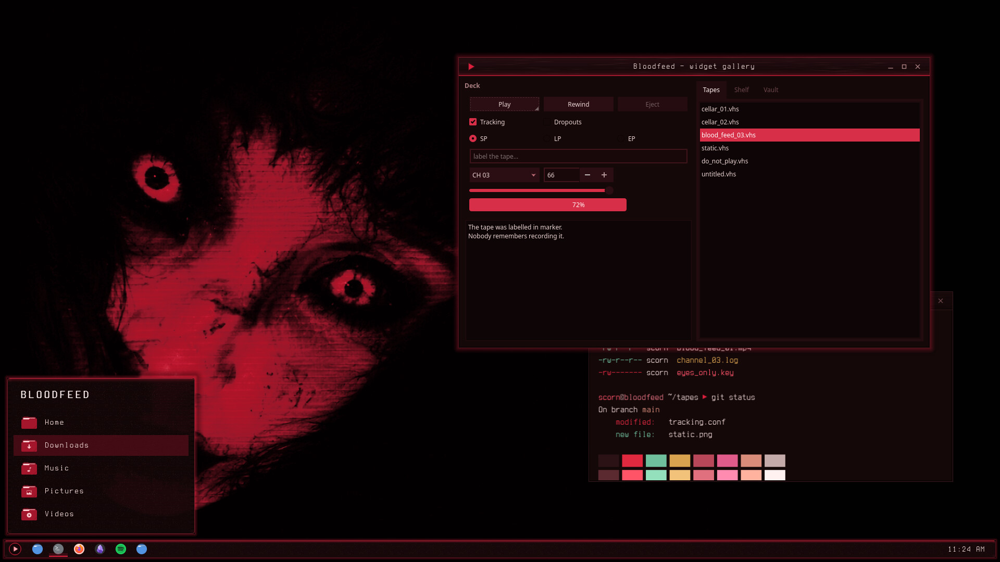
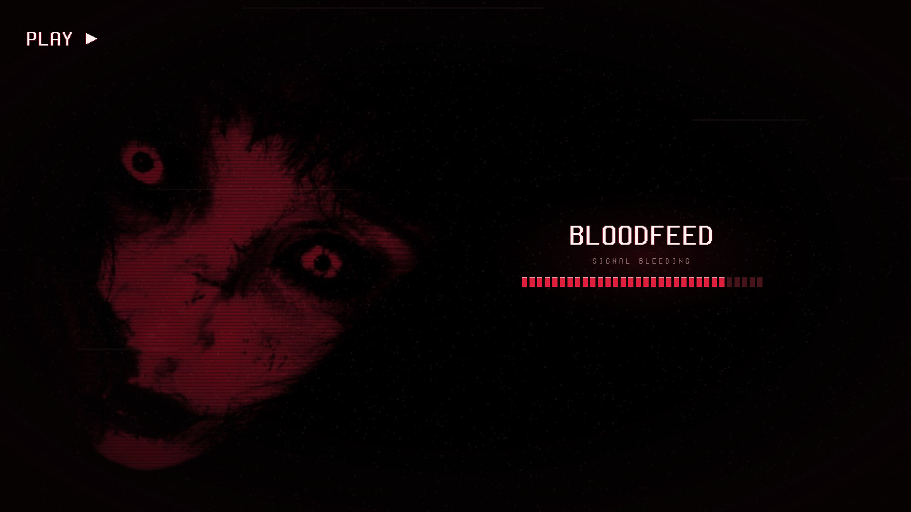
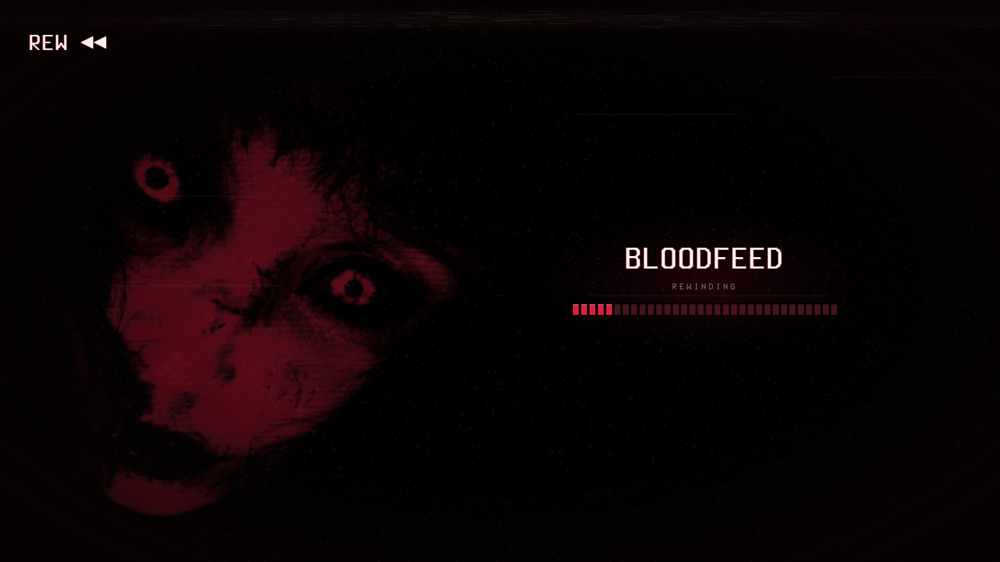
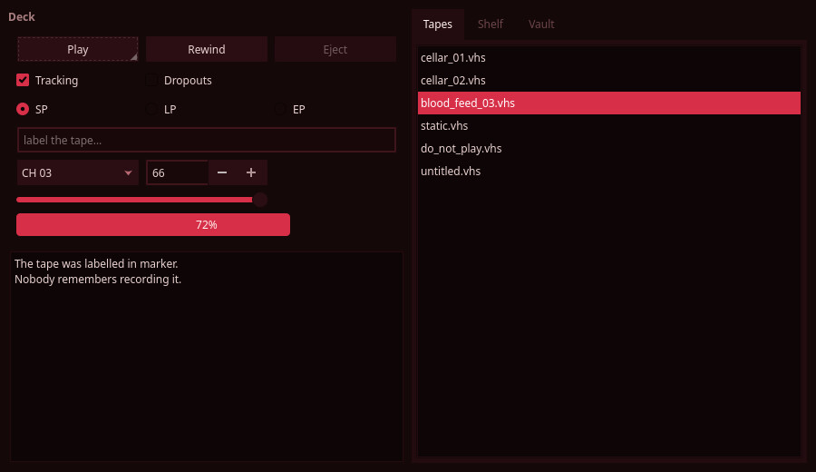
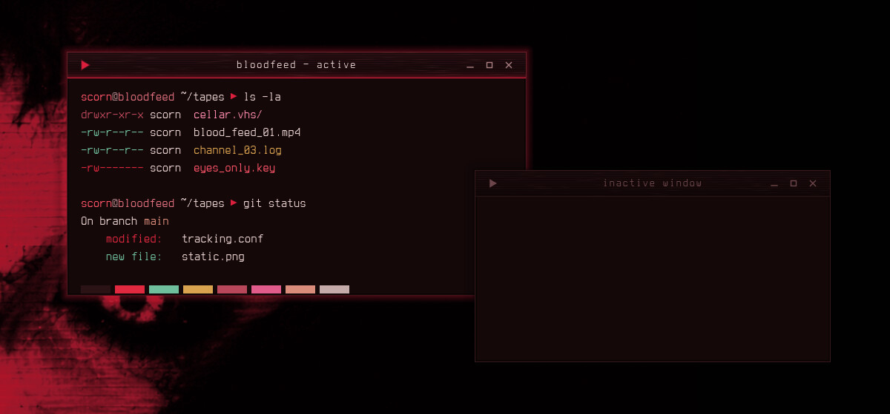
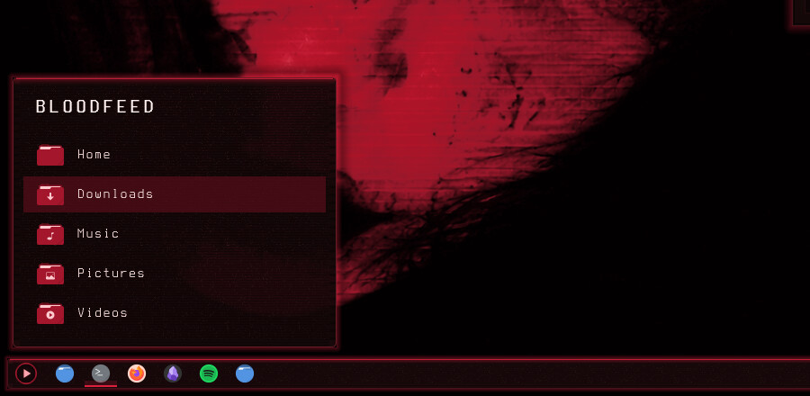
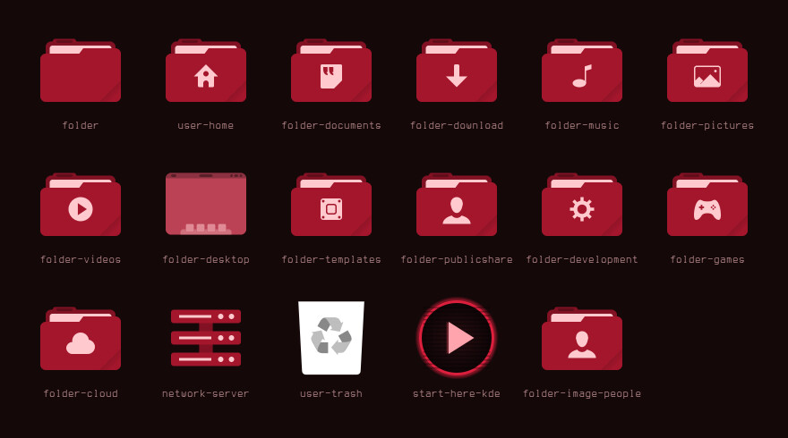
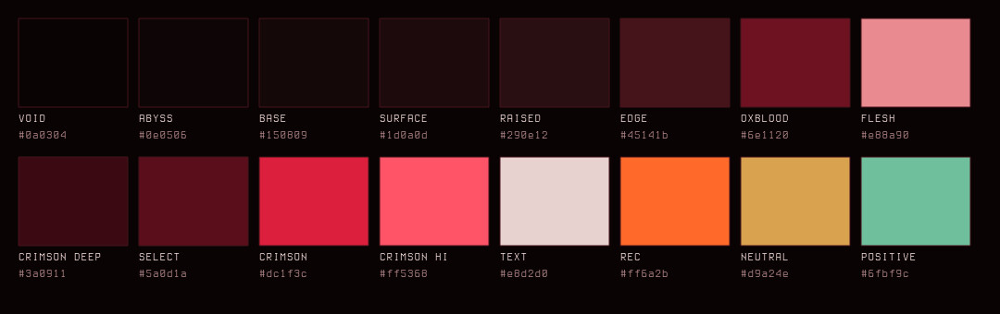

# Bloodfeed — Global Theme (Plasma 6)

A VHS tape dubbed in blood: red-black surfaces, faint scanlines and tape grain, a crimson glow on whatever has focus, and a rewind/play splash screen. One install switches the whole Plasma desktop.



Bloodfeed is the crimson cut of [Nightfeed](https://github.com/numbpill3d/nightfeed-global). Same tape, same face, re-lit: every surface carries a red cast instead of cobalt, accents glow crimson instead of violet, and the text is warm bone.

## Features

- **Splash screen:** the tape rewinds (`REW ◀◀`, fast tracking band) and then plays (`PLAY ▶`, **SIGNAL BLEEDING**). Crimson tape blocks fill as Plasma's six startup stages arrive.
- **Everything the global theme points at ships in this repo,** so applying it never falls back to Breeze:
  - **Colour scheme:** blood-black surfaces (window `#150809`, views `#0e0506`, borders `#45141b`), crimson accent `#dc1f3c`, dim oxblood selections `#5a0d1a`, bone text `#e8d2d0`. Negative is a hotter scarlet-orange so errors never blend into the accent.
  - **Plasma style:** blood-black glass panel, popups and tooltips with tiled scanlines and grain, a crimson glow seam and crimson-tinted shadows. Translucent and solid variants.
  - **Aurorae window decoration:** scanline title bar with tape-grain streaks, a crimson seam, a crimson glow around the active window, and VCR transport buttons.
  - **Kvantum widget style:** KvArcDark's engine map recoloured onto a red-black ramp with crimson sliders, checks and progress bars, and recessed text fields.
  - **Icons:** crimson folders and places with pale-pink glyphs, plus a VHS `▶ PLAY` launcher icon, over Tela circle dark.
- **Ships no panel layout,** so applying it never rearranges your panels or widgets.









## Requirements

- Plasma 6.
- [Kvantum](https://github.com/tsujan/Kvantum) (`kvantum` package) for the widget style. Without it, apps use your fallback Qt style.
- [Tela circle icon theme](https://github.com/vinceliuice/Tela-circle-icon-theme), dark variant (`Tela-circle-dark`). The Bloodfeed icons only replace folders and places and inherit everything else from it.

## Install

```bash
git clone https://github.com/numbpill3d/bloodfeed-global
cd bloodfeed-global && ./install.sh           # copy only
./install.sh --apply                          # copy and switch to Bloodfeed
```

Without `--apply`, pick **Bloodfeed** in System Settings → Colors & Themes → Global Theme. Global themes can't set the Kvantum theme, so open Kvantum Manager and pick **Bloodfeed** there (`--apply` does this for you).

To install only the look-and-feel package and splash, download `scorn.bloodfeed.tar.gz` from [Releases](https://github.com/numbpill3d/bloodfeed-global/releases) and use System Settings → Colors & Themes → Global Theme → Install from File. The splash alone can be picked under Colors & Themes → Splash Screen.

## Layout

| path | installs to |
|---|---|
| `metadata.json`, `contents/` | `~/.local/share/plasma/look-and-feel/scorn.bloodfeed/` |
| `extras/colors/Bloodfeed.colors` | `~/.local/share/color-schemes/` |
| `extras/plasma/Bloodfeed` | `~/.local/share/plasma/desktoptheme/` |
| `extras/aurorae/Bloodfeed` | `~/.local/share/aurorae/themes/` |
| `extras/icons/Bloodfeed` | `~/.local/share/icons/` |
| `extras/kvantum/Bloodfeed` | `~/.config/Kvantum/` |

## The rest of the suite

The pieces above are bundled here. The login screen and boot splash need root, so they ship separately:

| piece | repo |
|---|---|
| SDDM login | [bloodfeed-sddm](https://github.com/numbpill3d/bloodfeed-sddm) |
| Plymouth boot splash | [bloodfeed-plymouth](https://github.com/numbpill3d/bloodfeed-plymouth) |
| Plasma style | [bloodfeed-plasma](https://github.com/numbpill3d/bloodfeed-plasma) |
| Aurorae window decoration | [bloodfeed-aurorae](https://github.com/numbpill3d/bloodfeed-aurorae) |
| Colour scheme | [bloodfeed-colors](https://github.com/numbpill3d/bloodfeed-colors) |
| Kvantum widget style | [bloodfeed-kvantum](https://github.com/numbpill3d/bloodfeed-kvantum) |
| Icon theme | [bloodfeed-icons](https://github.com/numbpill3d/bloodfeed-icons) |
| Konsole + kitty colours | [bloodfeed-konsole](https://github.com/numbpill3d/bloodfeed-konsole) |

Everything at once, with the generators: [bloodfeed](https://github.com/numbpill3d/bloodfeed).

## Tags

`bloodfeed` `kde` `plasma6` `plasma-6` `dark` `vhs` `scanlines` `crimson` `red` `blood` `horror` `analog-horror` `retro` `glow` `global-theme` `look-and-feel` `splash-screen` `ksplash` `kde-theme` `kvantum`

## Credits and licence

By splicer scorn (voidrane). GPL-3.0-or-later.
OSD font: Terminess Nerd Font (Terminus, SIL OFL 1.1), bundled with its licence.
Kvantum engine map adapted from KvArcDark by Tsu Jan (Kvantum, GPL-3.0).
Folder artwork recoloured from Tela circle icon theme by Vince Liuice (GPL-3.0).
